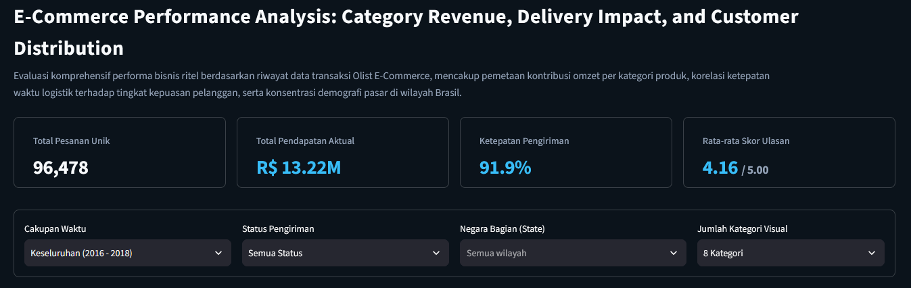
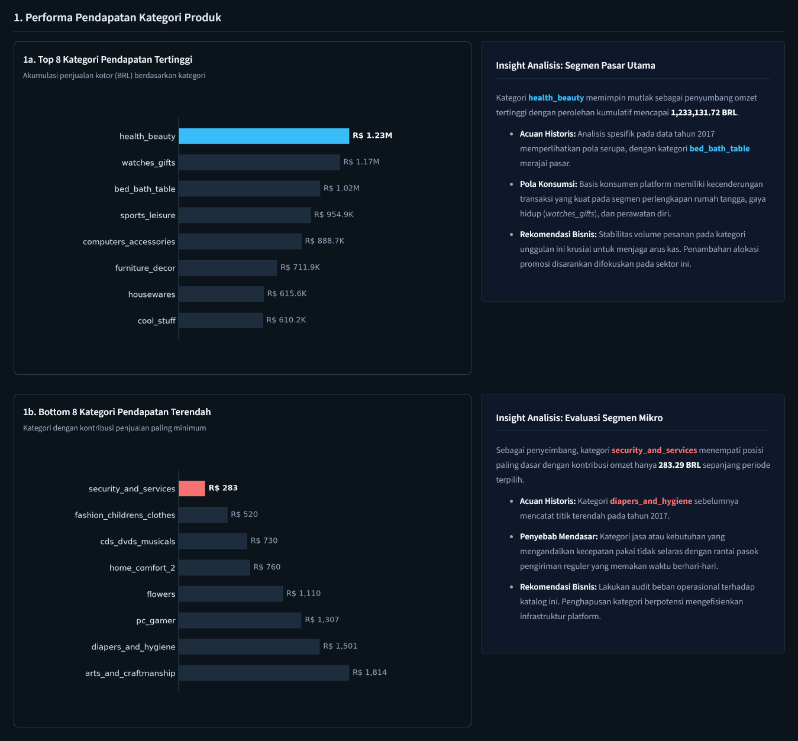
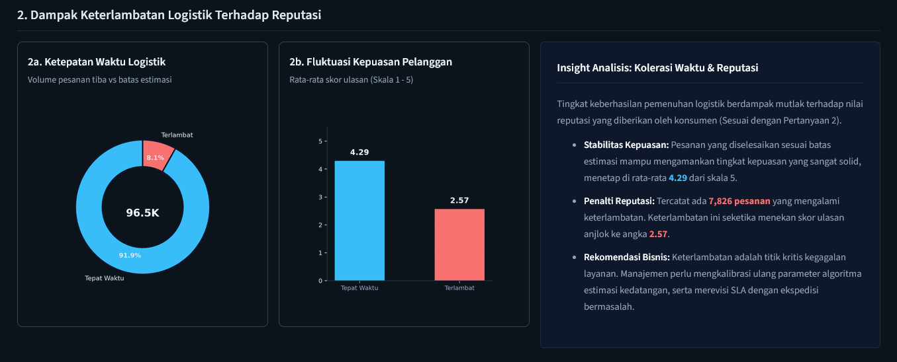
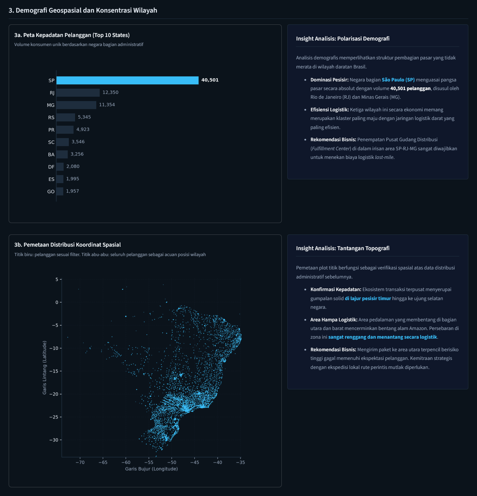

# Brazilian E-Commerce Performance Analysis

[](https://sidqi-brazilian-ecommerce-performance-analysis.streamlit.app/)
[](#5-technology-stack--tooling)
[](#2-data-wrangling--preprocessing-python)
[](LICENSE)

An end-to-end data analytics case study on the operational performance of Olist, a Brazilian e-commerce platform. The project covers data wrangling, exploratory data analysis (EDA), geospatial mapping of customers, and an interactive dashboard deployed with Streamlit.

📊 **[Live Interactive Dashboard (Streamlit Cloud)](https://sidqi-brazilian-ecommerce-performance-analysis.streamlit.app/)**  
📊 **[Exploratory Data Analysis Notebook](notebook.ipynb)**

---

## 1. Executive Summary & Business Problem
The dataset contains **96,478 delivered orders** with **R$ 13.22M** in item revenue (product price, excluding freight) between 2016 and 2018. The project analyzes this transaction history to review the product catalog, measure delivery performance, and map where customers are located.

**Business Questions:**
1. **Revenue Contribution:** Which product categories generated the highest and lowest total revenue (BRL)? The notebook answers this for 2017, and the dashboard shows any period.
2. **Delivery & Reviews:** How much lower is the average customer review score (scale 1-5) when an order arrives after its estimated delivery date, and what share of orders is late? (2016-2018)
3. **Geospatial Distribution (Advanced Analysis):** How are customers distributed across Brazilian states and zip codes, and what does this suggest for fulfillment center placement?

---

## 2. Data Wrangling & Preprocessing (Python)
The raw data consists of 9 relational tables (customers, orders, items, payments, reviews, products, sellers, category translation, and geolocation).

### Data Quality & Processing Logic
* **Gathering & Merging:** Merged orders, items, products, reviews, customers, and geolocation with `pd.merge()` into a single dataset (`dashboard/main_data.csv`) for the dashboard.
* **Category Translation (`product_category_name_english`):** Translated product categories from Portuguese to English using `product_category_name_translation.csv`.
* **Data Types:** Converted the order date columns to `datetime`.
* **Missing Values:**
  * Limited the analysis to orders with status `delivered`, since missing delivery dates mainly belong to canceled or unavailable orders.
  * Filled 610 missing product categories with "Unknown", filled missing product metadata with 0, and dropped 2 rows without package dimensions.
* **Duplicates:** Removed 261,831 duplicate rows from the geolocation table.
* **Outliers:** Kept 8,427 price outliers (7.48%), since they are valid high-value purchases.

---

## 3. Exploratory Data Analysis & Business Dashboard

The Streamlit dashboard has KPI cards, filters for period, delivery status, and state, and an insight panel next to each chart. All charts and insights update with the filters. *The dashboard text is in Indonesian.*

### A. Category Revenue Performance

* **Highest Revenue:** Over 2016-2018, `health_beauty` leads with **R$ 1.23M**, followed by `watches_gifts` (R$ 1.17M) and `bed_bath_table` (R$ 1.02M). In 2017 alone, `bed_bath_table` leads with R$ 490.6K.
* **Lowest Revenue:** Categories such as `security_and_services` earned only **R$ 283** in total over the three years.

### B. The Cost of Logistical Delays

* **On-time orders:** **91.9%** (88,652 orders) arrived on or before the estimated delivery date, with an average review score of **4.29 / 5.00**.
* **Late orders:** The **7,826 orders (8.1%)** that missed the estimate had a much lower average review score of **2.57 / 5.00**.

### C. Advanced Analysis: Geospatial Distribution

* **Customer Concentration:** **São Paulo (SP)** has the most customers (**40,501**), followed by Rio de Janeiro (RJ, 12,350) and Minas Gerais (MG, 11,354). Together these three states hold about two-thirds of all customers.
* **Sparse Regions:** The northern and western regions (Amazon basin) have far fewer customers, spread over long distances. This likely makes delivery harder there, although the data has no cost information to confirm it.

---

## 4. Conclusion & Strategic Recommendations

### Conclusions
1. Revenue is concentrated in home, lifestyle, and personal care categories, while some categories (e.g., security services, CDs/DVDs) earn almost nothing.
2. Late deliveries go together with much lower review scores (2.57 vs 4.29 on average).
3. Customers are concentrated in the southeastern states (SP, RJ, MG), and are much sparser in the north and west.

### Business Recommendations (Action Items)
* **Catalog Optimization:** Prioritize marketing budget and stock for the top categories (`health_beauty`, `watches_gifts`, etc.), and review the profitability of the lowest categories before deciding whether to keep them.
* **Delivery SLA Review:** Review the delivery estimate logic and the performance of carriers on late orders, with the aim of reducing the 8.1% late rate.
* **Fulfillment Center Placement:** Consider a distribution hub in the SP-RJ-MG area to shorten delivery times for the core customer base, after checking that the cost is justified.

### Notes & Limitations
* The review score comparison shows an association, not a proven cause. Other factors, such as product quality, were not analyzed.
* The data has no carrier or cost information, so the delivery and hub recommendations are hypotheses to test.
* Customer counts use `customer_id`, which is assigned per order, so they are closer to order counts than to unique people.
* 2016 has very little data (about 0.3% of revenue), so year-to-year comparisons should be read with care.

---

## 5. Technology Stack & Tooling

| Domain | Technology / Tool | Application |
| :--- | :--- | :--- |
| **Data Wrangling** | Python, Pandas, NumPy | Data cleaning, type conversion, merging tables |
| **Data Visualization** | Matplotlib, Seaborn | Charts in the notebook and dashboard |
| **Geospatial Analysis** | Pandas, Matplotlib | Customer map from zip code coordinates |
| **Dashboard** | Streamlit, Streamlit Cloud | Interactive dashboard and hosting |

---

## 6. How to Run & Inspect

### Directory Structure
```text
brazilian-ecommerce-performance-analysis
├── dashboard
│   ├── dashboard.py
│   ├── main_data.csv
│   └── images
├── data
│   ├── customers_dataset.csv
│   ├── geolocation_dataset.csv
│   ├── order_items_dataset.csv
│   ├── order_payments_dataset.csv
│   ├── order_reviews_dataset.csv
│   ├── orders_dataset.csv
│   ├── product_category_name_translation.csv
│   ├── products_dataset.csv
│   └── sellers_dataset.csv
├── LICENSE
├── notebook.ipynb
├── README.md
└── requirements.txt
```

### Local Deployment Instructions
**1. Clone the repository:**
```bash
git clone https://github.com/SidqiRaafi/brazilian-ecommerce-performance-analysis.git
cd brazilian-ecommerce-performance-analysis
```

**2. (Optional) Create a virtual environment:**
```bash
python -m venv venv
# Windows: .\venv\Scripts\activate
# macOS/Linux: source venv/bin/activate
```

**3. Install dependencies:**
```bash
pip install -r requirements.txt
```

**4. Run the Streamlit app:**
```bash
streamlit run dashboard/dashboard.py
```

To rerun the analysis, open `notebook.ipynb` in Jupyter or Google Colab with the `data` folder in the same directory. The last section of the notebook regenerates `dashboard/main_data.csv`.

---

## 7. Data Source & License
Data: [Brazilian E-Commerce Public Dataset by Olist](https://www.kaggle.com/datasets/olistbr/brazilian-ecommerce) on Kaggle. Please check the dataset's license terms before reusing it.

Code: released under the [MIT License](LICENSE).

**Author:** Sidqi Raafi Al Fauzan - [GitHub](https://github.com/SidqiRaafi)
